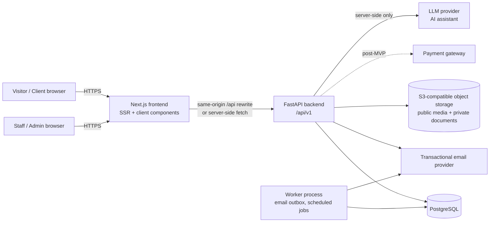
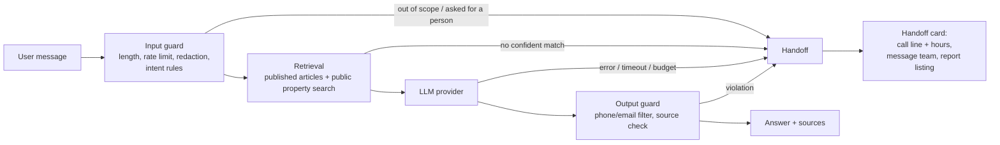

# Architecture

**Status:** Draft v0.1 (ratified in task J-1.1) · **Joint ownership** · Decisions behind this document are in `docs/DECISIONS.md`.

## 1. System context



## 2. Technology

| Layer | Choice | Notes |
|---|---|---|
| Frontend | Next.js (App Router), React, TypeScript (strict), Tailwind CSS | Server components for public SEO pages; client components for interactive forms/dashboards |
| Frontend tests | Vitest + React Testing Library; Playwright for E2E | |
| Backend | Python 3.12, FastAPI, Pydantic v2 | OpenAPI is generated from code and is the machine-readable contract |
| ORM / migrations | SQLAlchemy 2.x, Alembic | One migration per task; never edit an applied migration |
| Database | PostgreSQL 16 | `citext`, `pg_trgm` extensions (search) |
| Backend tests | pytest, httpx test client, factory-boy, Testcontainers/Docker Postgres | Tests run against real PostgreSQL, not SQLite |
| Quality | ruff, mypy (backend); ESLint, `tsc --noEmit`, Prettier (frontend) | |
| AI assistant | LLM provider behind a backend interface (provider/model: OQ-23); retrieval over published knowledge articles + public property search; mock LLM client in tests | API key, prompts and model settings exist only on the server |
| Local dev | `docker-compose.yml` for Postgres (+ MinIO for object storage, Mailpit for email) | |

## 3. Repository layout and ownership

```
/
├─ PRD.md                      joint
├─ agents/                     joint (role instructions)
├─ docs/                       see ownership table
├─ frontend/                   Developer 1
│  ├─ src/app/                 (public) (auth) (client) (admin) route groups
│  ├─ src/components/ui/       design-system primitives
│  ├─ src/components/features/ feature components (property, inquiry, ...)
│  ├─ src/lib/api/             generated types + typed client (no business rules)
│  ├─ src/lib/auth/            session helpers, route guards (UX only)
│  ├─ src/mocks/               TEMP-MOCK handlers only (see §8)
│  └─ tests/
├─ backend/                    Developer 2
│  ├─ app/api/v1/              routers (thin)
│  ├─ app/core/                config, security, errors, logging
│  ├─ app/models/              SQLAlchemy models
│  ├─ app/schemas/             Pydantic request/response models
│  ├─ app/services/            business logic
│  ├─ app/repositories/        DB access
│  ├─ app/workers/             outbox + scheduled jobs
│  ├─ alembic/
│  └─ tests/{unit,api,integration}/
├─ e2e/                        joint (Playwright, runs against real stack)
├─ .github/                    workflows, CODEOWNERS, PR template (joint; each dev owns their workflow file)
├─ docker-compose.yml          joint (lead: backend)
└─ README.md                   joint
```

| Path | Owner | Others may |
|---|---|---|
| `frontend/**`, `docs/UI_DESIGN_SYSTEM.md` | Developer 1 | Review only |
| `backend/**`, `docs/DATABASE_SCHEMA.md` | Developer 2 | Review only |
| `docs/API_CONTRACT.md`, `docs/ARCHITECTURE.md`, `docs/DECISIONS.md`, `PRD.md`, `docs/IMPLEMENTATION_PLAN.md` | Both | Changes need both approvals (CODEOWNERS lists both) |
| `docs/PROGRESS.md` | Both | Each developer updates only rows they own; joint rows updated by the person who completes the task |
| `e2e/**` | Both | Either may add tests; failing E2E must be triaged by the owner of the failing side |
| `.github/workflows/backend.yml` / `frontend.yml` | Backend / Frontend | |

## 4. Backend structure

Request flow: `router → dependency (auth, permission) → service → repository → database`.

- **Routers** only parse input, call a service, and shape the response. No business logic.
- **Services** hold all business rules: status state machines, fee calculation, publish gating, privacy filtering. Services are unit-testable without HTTP.
- **Repositories** own queries; no raw SQL in routers.
- **Schemas** are split by audience: `*Public`, `*Client`, `*Admin`. A public endpoint can never accidentally serialise a private field because the private fields do not exist on its schema.
- **Errors** are raised as typed domain exceptions and mapped once to the error envelope (`docs/API_CONTRACT.md` §3).
- **Authorization** is a default-deny dependency (`require_roles(...)`); object-level checks (e.g. a client reading only their own inquiry) live in services.
- **Time:** timezone-aware UTC everywhere. **Money:** integer kobo.

## 5. Frontend structure

- Route groups: `(public)` SSR pages (home, search, detail, policies, landlord form, report), `(auth)`, `(client)` account area, `(admin)` staff area.
- **Data access:** server components fetch directly from the backend using the request cookies; client components use the typed client in `src/lib/api`.
- **No business rules:** the frontend never calculates fees, decides who may publish, or decides visibility. It displays API values and mirrors validation for UX only; the server is authoritative.
- **Route guards** (`middleware.ts`, layout checks) are a UX layer. Hiding a button is never the access control.
- **State:** server state via a query library (TanStack Query) in client components; forms via React Hook Form + Zod (schemas mirror the contract).
- **Forms** display field errors from the error envelope `details[].field`.
- **Errors:** one `ApiError` type with `code: string` (open set). Unknown codes, non-JSON bodies, network errors and timeouts degrade by HTTP status to a safe generic message with the `request_id` (contract §2.4; design system §4).
- **Money:** one shared module for `formatMoney`, `formatMoneyCompact`, `parseMoneyInput`, tested against the vectors in contract §2.10.

## 6. Authentication flow (see ADR-003)

1. `POST /auth/login` sets three cookies: `access_token` (httpOnly, 15 min), `refresh_token` (httpOnly, 14 days, path `/api/v1/auth`), `csrf_token` (readable).
2. The browser calls `/api/*` on the **same origin** (Next.js rewrite to the backend), so no cross-origin cookies and no wide-open CORS.
3. Unsafe methods (`POST/PUT/PATCH/DELETE`) must send `X-CSRF-Token` equal to the `csrf_token` cookie.
4. On `401` with code `TOKEN_EXPIRED` the client calls `/auth/refresh` once, then retries. Refresh tokens rotate; reuse of an old refresh token revokes the whole family.
5. Server components forward the incoming cookies when calling the backend.

## 7. Key workflows (state machines owned by backend services)

**Property listing** — `draft → submitted → in_review ⇄ changes_requested → approved → published ⇄ unpublished`; `rejected` and `archived` are terminal-ish (`archived` can be reopened by admin). `published` requires verification `passed` and a current landlord approval (BR-01). Detailed transition table: `docs/API_CONTRACT.md` §7.

**Inquiry** — `new → in_progress → qualified → inspection_scheduled → negotiating → closed_won | closed_lost`, `spam` from any open state.

**Appointment** — `proposed → confirmed → completed`; `reschedule_requested`, `cancelled_by_*`, `no_show`.

**Transaction** — `open → offer_made → terms_agreed → fees_invoiced → completed`; `cancelled` from any non-terminal state.

Transition tables for inquiry, appointment and transaction are frozen in J-5.1, J-6.1 and J-6.7 respectively.

## 8. Mock policy (Rule 5)

Frontend may develop against mocks only if **all** of these hold:

1. Mocks live only in `frontend/src/mocks/` (MSW handlers).
2. Every handler carries a comment `// TEMP-MOCK: <METHOD> <path> — replace in <task-id>`.
3. The endpoint is written in the contract. `Agreed` or later is preferred; a `Draft` shape may be mocked too, but the mock comment must say `(Draft)` so it is revisited when the shape is agreed.
4. A mock-audit script lists active mocks; CI prints it, and the integration task for the feature (`J-x.y`) fails if any mock for that feature remains.
5. A feature is **not accepted** until its mocks are removed and the integration E2E passes against the real backend.

## 9. Contract workflow

1. Shape is proposed in `docs/API_CONTRACT.md` (status `Draft`).
2. Developers review and agree → status `Agreed` (recorded in the contract changelog). Agreement can happen asynchronously and is not a precondition for starting work on a `Draft` shape.
3. Backend implements → `Implemented` (OpenAPI matches; drift check passes).
4. Frontend integrates → `Integrated` (mocks removed, E2E green).
5. Any change after `Agreed` follows the change protocol in the contract (new version, changelog, the other developer reviews in the PR; breaking changes need an ADR).

## 10. Storage and media

- Storage abstraction with `local` (dev) and S3-compatible (prod) drivers.
- **Public bucket/prefix:** published property photos and videos (served via CDN-capable URLs).
- **Private bucket/prefix:** ownership and identity documents; accessed only through short-lived signed URLs generated for staff after an authorization check.
- Uploads validated by content sniffing (not just extension), size limits, filename sanitisation; images re-encoded and thumbnails produced to strip EXIF location data.
- Photos of unpublished or draft properties are private until publication.

## 11. Notifications

Transactional outbox: services write `email_outbox` rows inside the same DB transaction as the business change; a worker process sends them with retries. Dev uses Mailpit. In-app notifications (`notifications` table) are a Could.

## 11a. AI assistant with human handoff (ADR-014)



- **Backend-only.** The frontend never holds an LLM key or prompt; it renders messages as text.
- **Deterministic guards decide handoff**, not the model alone: category rules (payments, legal, complaints, account/transaction status, negotiation, distress), retrieval confidence threshold, repeated failure counter, output filter, and any provider failure.
- **Tools are read-only and public:** search published properties (public schema only) and fetch published knowledge articles. The assistant has no access to users, inquiries, transactions, landlords or documents. Its only write is the explicit, user-initiated "message the team" handoff, executed by the normal inquiry service.
- **Call line:** number and hours come from `site_settings` via `/public-config`; every handoff and the widget header include it.
- **Cost control:** per-IP/user rate limits, 1000-character messages, daily token budget with automatic handoff.
- **Observability:** every turn stores model, tokens, latency, intent and handoff reason (no raw IPs); flagged and handed-off conversations are reviewable by staff.
- **Testing:** mock LLM client in CI; golden-set and red-team suites (BE-6.31); live-model run before release.

## 12. Security baseline

- Argon2id password hashing; generic login errors; rate limiting on login, registration, password reset, public submission, reporting, and inquiry creation.
- Default-deny authorization with a role × endpoint matrix enforced by tests (`docs/API_CONTRACT.md` §5).
- Strict input validation; parameterised queries only; output encoding by React; CSP and standard security headers.
- Secrets only via environment; `.env.example` lists names, never values.
- PII minimisation, no PII in logs, audit log for staff actions, append-only ledger.
- Dependency audit in CI (`pip-audit`, `npm audit`).

## 13. Observability

JSON logs with `request_id`, user id (not email), route, status, duration. `X-Request-ID` returned on every response and included in error envelopes so support can trace an issue. Error monitoring provider chosen in OQ-20.

## 14. Testing strategy

| Level | Owner | Tooling | When |
|---|---|---|---|
| Backend unit (services, fee maths, state machines) | Backend | pytest | Every task |
| Backend API tests (authz matrix, validation, envelope, privacy) | Backend | pytest + httpx | Every endpoint task |
| Migration tests (up/down on empty and seeded DB) | Backend | pytest + alembic | Every migration task |
| Frontend unit/component | Frontend | Vitest + RTL | Every UI task |
| Contract conformance | Both | OpenAPI drift check, generated types, typecheck | CI on every PR |
| Integration / E2E (`J-x.y`) | Both | Playwright vs real stack | End of every module phase |
| Security review | Both | Checklist in `agents/CODE_REVIEWER.md` + Phase 7 tasks | Phase 7 + every auth/upload change |
| Accessibility | Frontend | axe in Playwright | UI tasks + Phase 7 |
| Assistant evaluation (golden set, handoff triggers, prompt injection, PII, refusals) | Backend + QA | pytest with recorded/mock model outputs; live-model run before release | BE-6.31, J-6.34, BE-7.2 |

Reporting rule: results recorded in `docs/PROGRESS.md` must be the actual command output summary (pass/fail counts), never assumed.

## 15. Environments and delivery

| Env | Purpose |
|---|---|
| Local | docker-compose + `npm run dev` + `uvicorn` |
| CI | Ephemeral Postgres; backend and frontend workflows path-filtered |
| Staging | Production-like; UAT (J-7.7) |
| Production | After release acceptance |

Branching: trunk-based with short-lived feature branches and PRs into `main`; see `agents/ORCHESTRATOR.md` §7. Hosting specifics are OQ-20.

## 16. Non-functional hooks in the design

| NFR | Design response |
|---|---|
| NFR-01/02 | Indexed search (`area_id`, price, type, bedrooms, status), `pg_trgm` for `q`; paginated; thumbnails + `next/image` |
| NFR-03 | SSR public pages, slugs, metadata, sitemap (FE-7.6) |
| NFR-05 | Section 12 |
| NFR-07/08 | Backup policy in BE-7.5, structured logs |

### Temporary deployed review authentication (superseded by real authentication)

Before the FastAPI identity module, the authorized team-review build uses a separate Next.js Node route `/api/review-auth` and private `REVIEW_SESSION_SECRET` / `REVIEW_ACCOUNTS_JSON` host variables. This is not `/api/v1/auth`. All private pages verify signed HttpOnly session cookies on the server; registration cannot choose privileged roles. Real invitations, password management and production role persistence remain backend work. Disable review mode and rotate the review secret on migration. Configuration and limitations: `docs/UNIFIED_REVIEW_SIGN_IN.md`.

### Database-backed authentication integration (2026-10-31)

ADR-003 is implemented in `backend/app/api/v1`, `core`, `services`, `repositories`, and PostgreSQL identity models/migrations. Neon supplies PostgreSQL only; application authentication remains FastAPI/Argon2id/JWT plus rotating opaque refresh cookies. Anonymous forms bootstrap signed CSRF at `/api/v1/auth/csrf`; every unsafe auth/admin request checks the exact configured Origin and signed double-submit cookie/header. Admin roles/activity are read from PostgreSQL on every protected request. Test/dev email uses a private outbox; configured SMTP delivery is an explicit operator command.

The temporary Next review endpoint and private review account list are removed. Frontend SSR forwards the access cookie to `/auth/me`; `/session/restore` performs browser-side refresh at the auth cookie path when necessary, preserving safe return URLs. Browser access guards remain UX; FastAPI enforces API permissions. See `docs/BACKEND_AUTHENTICATION.md` for evidence, configuration and rollout boundaries.
