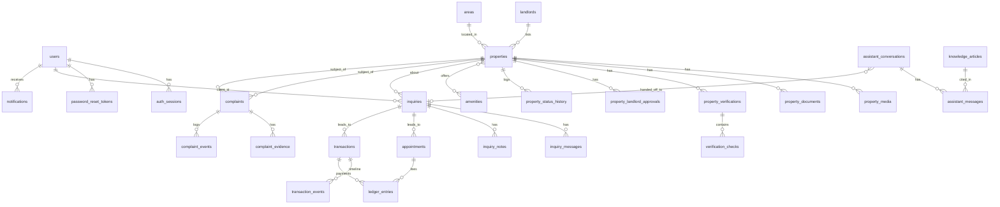

# Database Schema

**Owner:** Developer 2 (Backend) · **Status:** Draft v0.5 (identity, property metadata and landlord submissions implemented) — finalised in BE-1.2, reviewed by Developer 1 for API fit · **Engine:** PostgreSQL 16 · **Migrations:** Alembic

Changes to this file that affect API shapes must go through the contract change protocol (`docs/API_CONTRACT.md` §1).

## 1. Conventions

| Topic | Rule |
|---|---|
| Naming | `snake_case`, plural table names, singular column names; FK columns `<table_singular>_id` |
| Primary keys | `id uuid` (generated by the application, UUIDv7 where available else v4) |
| Timestamps | `created_at timestamptz NOT NULL DEFAULT now()`, `updated_at timestamptz NOT NULL` (maintained by ORM). Always UTC |
| Concurrency | Editable aggregates carry `row_version integer NOT NULL DEFAULT 1`, exposed as `version` |
| Enums | `varchar` + `CHECK (col IN (...))` (not PostgreSQL enum types) so that adding a value is a simple migration |
| Money | `bigint` kobo + `currency char(3) NOT NULL DEFAULT 'NGN'`; never floats or numeric for money |
| Text search | `pg_trgm` GIN index on searchable text; `citext` for email |
| Foreign keys | `ON DELETE RESTRICT` by default. Business data is archived, not deleted. `CASCADE` only for pure child rows (media of a property, join tables) and only where stated |
| Soft delete | Not used. Use `status`/`is_active`/`archived_at` |
| Append-only tables | `audit_log`, `ledger_entries`, `*_status_history`, `transaction_events` — no UPDATE/DELETE from application code (enforced by repository design and a test) |
| Migrations | One migration per task; reversible (`downgrade` implemented); never edit an applied migration; data migrations separate from schema migrations; every migration tested up/down on an empty and a seeded database |
| PII classes | **P1** public; **P2** personal (client contact); **P3** sensitive (landlord contact, ID/ownership documents, exact address). P3 never leaves staff-only endpoints (BR-03) |

## 2. Entity overview

## 3. Identity and access

### `users`  (P2)
| Column | Type | Notes |
|---|---|---|
| id | uuid PK | |
| email | citext NOT NULL UNIQUE | lower-cased |
| password_hash | text NOT NULL | Argon2id |
| full_name | varchar(150) NOT NULL | |
| phone | varchar(20) | E.164; required for clients, optional for staff |
| role | varchar(10) NOT NULL | CHECK `client`,`staff`,`admin` |
| is_active | boolean NOT NULL DEFAULT true | |
| email_verified_at | timestamptz | |
| last_login_at | timestamptz | |
| row_version, created_at, updated_at | | |

Index: unique(email). Seed: admin from env via CLI (BE-3.1).

### `auth_sessions`  (refresh tokens)
`id`, `user_id` FK, `token_hash char(64)` UNIQUE (SHA-256 of token), `family_id uuid` (rotation family), `expires_at`, `revoked_at`, `replaced_by_id` FK self, `user_agent varchar(255)`, `ip inet`, `created_at`. Indexes: `user_id`, `family_id`.

### `password_reset_tokens`
`id`, `user_id` FK, `token_hash char(64)` UNIQUE, `purpose varchar(20)` CHECK (`reset`,`invitation`,`verification`), `expires_at`, `used_at`, `created_at`. Purpose prevents verification links being used as password-reset links; all are single-use and ≤1 hour. Only digests are stored here.

### `auth_rate_limits`
`key char(64)` PK (HMAC of operation/IP or normalized email), `count integer`, `reset_at timestamptz` indexed. PostgreSQL atomic upsert and committed attempts enforce contract limits across backend workers without storing raw email/IP in bucket keys. Expired buckets can be pruned by an operator; account/auth failures do not roll back attempts.

### `policy_acceptances`  (consent records, FR-POL-02)
`id`, `user_id` FK NULL, `landlord_id` FK NULL, `policy_type` CHECK (`terms`,`privacy`), `version varchar(20)`, `accepted_at`, `ip inet`. CHECK exactly one of `user_id`/`landlord_id` is set.

## 4. Property domain

### `areas`
`id`, `state varchar(60)`, `city varchar(60)`, `neighbourhood varchar(80)`, `slug varchar(100)` UNIQUE, `latitude numeric(9,6)`, `longitude numeric(9,6)` (centroid), `is_active boolean`. UNIQUE(`state`,`city`,`neighbourhood`). Data-driven so any city can be added (A-1).

### `amenities`
`id`, `code varchar(40)` UNIQUE, `label varchar(80)`, `category varchar(30)`, `sort_order int`, `is_active`.

### `landlords`  (P3)
| Column | Type | Notes |
|---|---|---|
| id | uuid PK | |
| full_name | varchar(150) NOT NULL | |
| phone | varchar(20) NOT NULL | E.164, indexed (staff dedupe) |
| email | citext | |
| identity_verified_at | timestamptz | set by staff |
| identity_verified_by | uuid FK users | |
| blocked_at | timestamptz | set only by an admin after a substantiated complaint (FR-CMP-05) |
| blocked_reason | text | staff-only; completed submissions matching a blocked landlord's phone/email remain `submitted`, with a private staff-review note and audit flag, never auto-rejected (owner override 2026-11-02) |
| notes | text | staff-only |
| created_at, updated_at | | |

No unique constraint on phone/email — one person may appear twice until staff merge; merge is out of MVP (manual).

### `properties`
| Column | Type | Notes |
|---|---|---|
| id | uuid PK | |
| slug | varchar(160) NOT NULL UNIQUE | title + short id suffix |
| landlord_id | uuid FK landlords NOT NULL | |
| area_id | uuid FK areas NOT NULL | |
| title | varchar(120) NOT NULL | |
| description | text NOT NULL | |
| listing_type | varchar(10) NOT NULL | `rent`,`sale` |
| property_type | varchar(20) NOT NULL | |
| intended_use | varchar(20) NOT NULL DEFAULT 'residential' | CHECK currently only `residential` (OQ-10) |
| relationship | varchar(30) NOT NULL | landlord relationship |
| price_amount | bigint NOT NULL CHECK > 0 | kobo |
| currency | varchar(3) NOT NULL DEFAULT 'NGN' | |
| price_period | varchar(10) NOT NULL | `year`,`month`,`one_time`; CHECK `one_time` iff `sale` |
| price_negotiable | boolean NOT NULL DEFAULT false | |
| payment_terms | text | |
| extra_charges | jsonb NOT NULL DEFAULT '[]' | `[{label, amount, currency}]`, validated by schema |
| bedrooms, bathrooms | smallint NOT NULL | 0–20 |
| furnishing | varchar(15) NOT NULL | |
| address_line | text NOT NULL | **P3** |
| address_hint | varchar(160) | public street-level hint |
| latitude, longitude | numeric(9,6) | **P3**; API returns approximate only |
| landlord_conditions | text | |
| status | varchar(20) NOT NULL | property_status enum |
| availability_status | varchar(15) NOT NULL DEFAULT 'available' | |
| last_availability_confirmed_at | timestamptz | |
| assigned_staff_id | uuid FK users | |
| submitted_at, published_at, verified_at, archived_at | timestamptz | |
| rejection_reason | text | |
| row_version, created_at, updated_at | | |

Indexes: `(status, published_at DESC)`, `(area_id)`, `(listing_type, property_type)`, `(price_amount)`, `(bedrooms)`, `(availability_status)`, `(assigned_staff_id, status)`, GIN trgm on `title || ' ' || description`. A partial index `WHERE status='published'` backs public search.

### `property_amenities`
`property_id` FK CASCADE, `amenity_id` FK, PK(`property_id`,`amenity_id`).

### `property_media`
`id`, `property_id` FK CASCADE, `kind` (`photo`,`video`), `storage_key text`, `thumb_key text`, `original_filename varchar(255)`, `mime_type`, `size_bytes bigint`, `width int`, `height int`, `alt_text varchar(200)`, `position int`, `is_cover boolean`, `uploaded_by` (`landlord_submission`,`staff`), `created_at`. Partial unique: one cover per property.

### `property_documents`  (**P3**, private storage)
`id`, `property_id` FK, `kind` (`ownership_proof`,`authorization_letter`,`id_document`,`other`), `storage_key`, `mime_type`, `size_bytes`, `review_note text`, `reviewed_by` FK users, `reviewed_at`, `created_at`.

### `property_verifications`
`id`, `property_id` FK, `status` (`in_progress`,`passed`,`failed`), `method` (`desk_review`,`physical_inspection`,`both`), `scope_summary text` (shown publicly as the verified scope), `verified_by` FK users, `verified_at`, `is_current boolean`, `created_at`. Partial unique on (`property_id`) WHERE `is_current`.

### `verification_checks`
`id`, `verification_id` FK CASCADE, `code` (identity, ownership_docs, location, price, features, availability), `result` (`pass`,`fail`,`na`), `note text`, `evidence_document_id` FK property_documents. UNIQUE(`verification_id`,`code`).

### `property_landlord_approvals`
`id`, `property_id` FK, `approved_price_amount bigint`, `approved_price_period`, `description_approved boolean`, `method` (phone, whatsapp, email, in_person), `note text`, `recorded_by` FK users, `approved_at timestamptz`, `superseded_at timestamptz`. Current approval = `superseded_at IS NULL`. The service sets `superseded_at` when price/description change (BR-01).

### `property_status_history`  (append-only)
`id`, `property_id` FK, `from_status`, `to_status`, `actor_user_id` FK NULL (null for public submitter), `reason text`, `created_at`.

## 5. Inquiry domain  (shapes frozen in J-5.1)

### `inquiries`
`id`, `client_id` FK users NOT NULL, `property_id` FK NULL (null = general inquiry), `kind` (`property_interest`,`inspection_request`,`general`), `source` (`web_form`,`assistant`) DEFAULT `web_form`, `status` (`new`,`in_progress`,`qualified`,`inspection_scheduled`,`negotiating`,`closed_won`,`closed_lost`,`spam`), `assigned_staff_id` FK, `budget_min bigint`, `budget_max bigint`, `desired_move_in date`, `qualified_at`, `closed_at`, `closed_reason text`, `last_client_message_at`, `last_staff_message_at`, `row_version`, `created_at`, `updated_at`. Partial unique `(client_id, property_id)` WHERE `status NOT IN ('closed_won','closed_lost','spam') AND property_id IS NOT NULL`. Indexes: `(status, created_at)`, `(assigned_staff_id, status)`, `(client_id, created_at)`. BE-5.2 implements these tables in `be52_inquiries`; assistant conversation linkage is deferred to the assistant module. Messages/notes have database length checks; budgets are nonnegative and ordered; kind/general property linkage is constrained.

### `inquiry_messages`
`id`, `inquiry_id` FK, `sender_id` FK users, `sender_role` (`client`,`staff`), `body text` (≤ 4000), `created_at`, `read_at`. Index `(inquiry_id, created_at, id)`.

### `inquiry_requests` (private idempotency)
`id` UUID, `client_id` FK users, `inquiry_id` FK inquiries, `key_hash` SHA256 varchar(64), `body_hash` SHA256 varchar(64), `created_at`. Unique `(client_id,key_hash)`. Original inquiry receipt is replayed for 24h for the same normalized body; expired keys can be replaced. Raw keys are never stored.

### `inquiry_notes`  (staff-only)
`id`, `inquiry_id` FK, `author_id` FK, `body text`, `created_at`.

### `inquiry_status_history`  (append-only)
`id`, `inquiry_id`, `from_status`, `to_status`, `actor_user_id`, `reason`, `created_at`.

## 6. Appointments  (J-6.1)

### `appointments`

Implemented by `be62_appointments` after `be52_inquiries`. UUID id; inquiry_id/property_id/client_id/staff_id FKs; scheduled_at/ends_at timestamptz; duration_minutes15..240 (ORM default45); status proposed/confirmed/reschedule_requested/completed/cancelled_by_client/cancelled_by_staff/cancelled_by_landlord/no_show. ends_at must equal scheduled_at + duration minutes. Private landlord_rep_name/phone, meeting_instructions, and meeting_address snapshot; address_disclosed_at records confirmation. requested_scheduled_at and reschedule_reason store a client request while the original slot remains reserved. cancellation_reason and outcome_notes are staff-only. outcome interested/not_interested/needs_follow_up|null. row_version and UTC created_at/updated_at.

Fee amount bigint is zero and status none, enforced by DB check for the disabled OQ-04 default; enabling fees requires a separate reviewed change. No payment operation here.

GiST exclusion constraints via btree_gist reject overlapping active half-open `[scheduled_at,ends_at)` staff or property slots. Active = proposed/confirmed/reschedule_requested. A partial unique inquiry_id index permits one active visit per inquiry. B-tree indexes support client/date, staff/date and status/date. Cancelled/completed/no_show records release reservations. The shared btree_gist extension is preserved on downgrade.

### `appointment_status_history` (append-only)

UUID id; appointment_id FK; from_status nullable/to_status; actor_user_id FK; reason text nullable; created_at timestamptz. Index appointment_id/created_at/id. PostgreSQL trigger rejects UPDATE/DELETE. Scheduling also appends inquiry history/audit for inspection_scheduled; cancellation/no_show returns eligible inquiries to qualified, never reopens closed inquiries. Actor and versions are server-owned.

Only own confirmed/completed client detail exposes meeting_address snapshot and meeting instructions. Client list never includes either. Cancellation/no_show/reschedule_requested withdraw disclosure, and staff rescheduling clears the snapshot until fresh confirmation. Landlord contacts/documents/coordinates/private notes remain excluded. Staff detail shows both current property address and the confirmed snapshot so property metadata edits cannot silently relocate a confirmed visit. Owner clarified this exception on 5 November 2026; see API v0.10.0 §4.7B.

## 7. Transactions and fees  (J-6.7)

### `fee_rules`
`id`, `listing_type`, `party` (`client`,`landlord`), `rate_bps integer` (basis points, 200 = 2%), `basis` (`annual_rent`,`first_payment`,`sale_price`), `min_fee bigint NULL`, `max_fee bigint NULL`, `effective_from date`, `effective_to date NULL`, `created_by` FK. Rules are never edited, only superseded.

### `transactions`
`id`, `inquiry_id` FK, `property_id` FK, `client_id` FK, `landlord_id` FK, `appointment_id` FK NULL, `type` (`rent`,`sale`), `status` (`open`,`offer_made`,`terms_agreed`,`fees_invoiced`,`completed`,`cancelled`), `agreed_price_amount bigint`, `agreed_price_period`, `fee_basis_amount bigint`, `client_fee_amount bigint`, `landlord_fee_amount bigint`, `fee_rules_snapshot jsonb` (rules used, so later rule changes never alter history), `terms_summary text`, `completed_at`, `cancelled_at`, `cancel_reason text`, `created_by` FK, `row_version`, `created_at`, `updated_at`.

### `transaction_events`  (append-only)
`id`, `transaction_id` FK, `kind` (`offer`,`counter_offer`,`terms_agreed`,`note`,`status_change`), `payload jsonb`, `actor_user_id`, `created_at`.

### `ledger_entries`  (append-only, BR-09)
`id`, `transaction_id` FK NULL, `appointment_id` FK NULL (at least one non-null), `party` (`client`,`landlord`), `kind` (`inspection_fee`,`service_fee`,`refund`,`credit`,`waiver`,`reversal`), `direction` (`in`,`out`), `amount bigint CHECK > 0`, `currency`, `method` (`bank_transfer`,`card`,`cash`,`other`), `reference text`, `reverses_entry_id` FK self NULL, `note`, `recorded_by` FK, `occurred_at`, `created_at`.

## 8. Complaints, notifications, audit

### `complaints`
Reports and complaints share one table. Every row is an **unverified allegation** until `status = 'resolved'` with an outcome (BR-16).

| Column | Type / values | Notes |
|---|---|---|
| id | uuid PK | |
| reference | derived, not stored | `CMP-<UUID>`, derived from the case ID; not an access credential |
| kind | `suspicious_listing`,`dispute`,`service_complaint`,`other` | |
| reason | `fake_listing`,`wrong_price`,`misleading_description`,`already_let_or_sold`,`unauthorised_agent`,`asked_to_pay_outside`,`other` | required when `kind='suspicious_listing'` |
| status | `new`,`triage`,`investigating`,`resolved`,`dismissed` | |
| reporter_user_id | uuid FK users NULL | **P3 staff-only** |
| reporter_name, reporter_email, reporter_phone | varchar(150/254/20), all NULL | **P3 staff-only**, anonymous reports |
| reporter_ip_hash | varchar(64) | HMAC-SHA-256 with server secret; raw IP never stored |
| property_id, appointment_id | uuid FK NULL | `property_id` required for `suspicious_listing`; transaction link deferred with 6B |
| description | text | plain text, HTML stripped, never logged |
| occurred_on | date NULL | |
| desired_outcome | text NULL | ≤ 500 chars |
| assigned_staff_id | uuid FK users NULL | |
| investigation_findings, evidence_reviewed | text NULL | staff-only |
| outcome | `substantiated`,`partially_substantiated`,`unsubstantiated`,`inconclusive` NULL | |
| actions_taken | text[] | values from `complaint_action`; `listing_rejected`/`landlord_blocked` require admin |
| dismiss_reason | `duplicate`,`spam_or_abuse`,`out_of_scope`,`insufficient_information` NULL | |
| public_note | text NULL | shown to the reporter |
| hold_property_id | uuid FK NULL | property under precautionary hold |
| hold_review_due_at | timestamptz NULL | now + 2 business days at hold time |
| first_response_at, resolved_at | timestamptz NULL | |
| upload_token_hash, upload_token_expires_at | varchar(64), timestamptz | Scoped random token stored hashed; 24-hour upload/removal access only |
| row_version, created_at, updated_at | integer, timestamptz, timestamptz | Evidence changes also increment the case version |

CHECKs: `status='resolved'` ⇒ `outcome`, `investigation_findings`, `evidence_reviewed` NOT NULL and `cardinality(actions_taken) ≥ 1`; `status='dismissed'` ⇒ `dismiss_reason` NOT NULL; Known reason/outcome/dismiss/action enums and substantiated permanent-action findings are checked in the database. Role/outcome guards are also enforced in the service at both save and resolve. Indexes: `(status, created_at)`, `(property_id)`, `(assigned_staff_id, status)`, `(hold_property_id, hold_review_due_at)`, `(reporter_user_id, created_at)`. Duplicate detection (same reporter or IP hash + property + reason within 24 h) is enforced in the service.

### `complaint_evidence`  (private storage)
`id`, `complaint_id` FK CASCADE, `storage_key`, `mime_type`, `size_bytes`, `created_at`. Max 3 per complaint (service check).

### `complaint_events`  (append-only)
`id`, `complaint_id` FK, `from_status`, `to_status`, `actor_user_id` FK NULL, `note text`, `created_at`.

### `notifications`  (Could)
`id`, `user_id` FK, `event_type`, `title`, `body`, `entity_type`, `entity_id`, `read_at`, `created_at`. Index `(user_id, read_at, created_at DESC)`.

### `email_outbox`
`id`, `to_email citext`, `template varchar(60)`, `payload jsonb`, `status` (`pending`,`sent`,`failed`), `attempts smallint`, `last_error text`, `send_after timestamptz`, `sent_at`, `created_at`. Index `(status, send_after)`. Payload excludes secrets beyond single-use links.

### `audit_log`  (append-only)
`id`, `actor_user_id` FK NULL, `actor_ip inet`, `action varchar(80)`, `entity_type varchar(40)`, `entity_id uuid`, `before jsonb`, `after jsonb`, `created_at`. Index `(entity_type, entity_id, created_at)`, `(actor_user_id, created_at)`. Never stores passwords or tokens; P3 fields in `before/after` are masked.

### 8b. AI assistant, knowledge base, settings  (J-6.28)

### `site_settings`
`key varchar(60)` PK, `value jsonb`, `updated_by` FK users, `updated_at`. Keys: `support_phone` (E.164), `support_hours` (`{timezone, days:[{day, open, close}]}`), `assistant_enabled` (bool), `assistant_daily_token_budget` (int). Every change is written to `audit_log`.

### `knowledge_articles`
`id`, `slug` UNIQUE, `title varchar(160)`, `body text` (markdown, rendered safely), `category` (`how_it_works`,`fees`,`verification`,`inspections`,`policies`,`reporting`,`contact`,`other`), `language char(2) DEFAULT 'en'`, `status` (`draft`,`published`), `published_by` FK users, `published_at`, `row_version`, `created_by`, `created_at`, `updated_at`. Only `published` rows are retrievable by the assistant. Index: GIN trgm on `title || ' ' || body`; an embedding column may be added later (ADR when decided).

### `assistant_conversations`
`id`, `user_id` FK NULL, `anon_token_hash char(64)` NULL, `ip_hash char(64)`, `status` (`active`,`handed_off`,`closed`), `handoff_reason` NULL, `handed_off_at`, `inquiry_id` FK NULL, `flagged boolean DEFAULT false`, `review_note text`, `created_at`, `updated_at`. CHECK: `user_id` or `anon_token_hash` is set.

### `assistant_messages`  (append-only)
`id`, `conversation_id` FK, `role` (`user`,`assistant`), `content text` (card-like numbers redacted), `sources jsonb` (`[{type,id}]`), `intent varchar(40)`, `handoff_reason` NULL, `model varchar(60)`, `tokens_in int`, `tokens_out int`, `latency_ms int`, `created_at`. Index `(conversation_id, created_at)`.

## 9. Seed data

| Seed | Content | Task |
|---|---|---|
| Admin | Created by CLI from env vars | BE-3.1 |
| Amenities | generator, borehole/water, parking, security, CCTV, gated estate, fitted kitchen, air conditioning, wardrobe, boys' quarters, swimming pool, gym, waste disposal, internet-ready, balcony, elevator | BE-4.2 |
| Areas | Launch city neighbourhoods (OQ-02 default Abuja) | BE-4.2 |
| Dev data | ≥ 30 properties across all statuses and types, placeholder images, 10 clients, 3 staff | BE-4.8 |
| Fee rules | Default 2%/2% rules effective from launch (after OQ-03) | BE-6.8 |
| Settings | `support_phone` placeholder, hours placeholder, `assistant_enabled=false` until configured | BE-6.29 |
| Knowledge articles | Initial FAQ set (drafts) from the proposal, published by an admin after founder approval (OQ-25) | BE-6.29 |

## 10. Query and performance notes

- Public search must filter on `status='published'` first (partial index) and use `EXPLAIN` evidence in BE-4.9.
- Staff queues use `(status, created_at)` indexes; counts for dashboards are computed with aggregate queries, not row loads.
- KPI queries (BE-6.23) read only timestamp columns listed in PRD section 9; any new KPI that needs a new column is a schema change request.

## 11. Data retention and privacy (pending OQ-18)

- Landlord documents and identity files are retained only while the property exists plus the retention period set by counsel; a purge job is specified in BE-7.5.
- Right-to-erasure handling for clients: anonymise `users` row and message authorship, retain transaction financial records as legally required — to be confirmed by counsel.
- Assistant transcripts: default retention 90 days, then anonymised or deleted by a scheduled job (OQ-23); flagged conversations may be kept longer for review with a recorded reason.
- Complaint evidence and reporter contact details follow the retention period set by counsel (OQ-18); reporter contact is purged first.

### Identity implementation scope (2026-10-31)

Alembic baseline implements users, sessions, purpose-scoped single-use tokens, user policy acceptances, private email outbox and database rate buckets. A separate BE-3.3 migration enforces audit append-only UPDATE/DELETE protection with a PostgreSQL trigger. The baseline originally required user_id for all consent. BE-4.2 adds nullable landlord_id and enforces exactly one subject (user or landlord), preserving existing user consent records. PostgreSQL 16-compatible SQL is used; local validation runs on the installed PostgreSQL 18 server. No existing Neon schema is modified until the user supplies development connection strings and explicitly runs the documented migration command.

### BE-4.2 property metadata implementation (2026-11-02)

Schema v0.4 adds the eleven §4 tables and landlord consent linkage in `be42_properties`, following the existing documented shapes; no API contract change. Taxonomies carry created/updated timestamps. Currency is varchar(3) with NGN check. Additional database invariants: nonnegative media position, positive size/dimensions, photo-only cover, unique storage keys, at most one video (OQ-13), one current landlord approval, coordinate bounds, positive row version and array-valued extra charges. Extra-charge item validation and upload counts/size/content limits are enforced by subsequent services, not this migration.

Property status history UPDATE/DELETE is blocked by a PostgreSQL trigger. Publication guard and cross-property evidence validation belong to workflow services (BE-4.6); metadata alone does not make a property verified/publishable. Deletion restrictions preserve private document/approval/history references.

Task downgrade preserves users and user consent but refuses to proceed if landlord consent exists, because the prior identity revision cannot represent it. pg_trgm extension remains installed on downgrade as shared infrastructure. No remote database migration has been run.

Reference seeds: 16 amenities from §9; 12 candidate Abuja neighbourhoods (Wuse 2, Gwarinpa, Maitama, Asokoro, Jabi, Utako, Garki, Kubwa, Lugbe, Apo, Katampe, Life Camp). Slugs/IDs are stable, unknown centroids remain null; repeated seeds preserve custom labels and activation state.

### BE-4.4 submission persistence (2026-11-02)

Schema v0.5, revision `be44_submissions`: properties.submission_reference nullable varchar(40), unique; sequence landlord_submission_reference_seq produces stable SUB-year-counter receipts (sequence gaps are expected). Submission references survive retries and never disclose landlord identity.

`storage_deletions` (P3): id uuid PK, storage_key text UNIQUE NOT NULL, attempts integer DEFAULT 0, created_at timestamptz DEFAULT now(). This private outbox commits with file-row removal, allowing private objects to be deleted/retried independently. Explicit cleanup-files command processes up to 20 queued entries with SKIP LOCKED; successful deletions remove the queue row. The schema downgrade refuses when references or pending deletion jobs exist, so rollback cannot silently discard operational records. No remote migration run.

Blocked-contact matching normalizes incoming phone/email and stores a private review note on the new landlord record plus an audit flag. It does not mark the new landlord blocked or automatically change the submission status; every completed submission remains submitted, per owner override.

### Complaint integration — v0.11.0 / `be615_complaints`

The migration follows `be62_appointments` and creates `complaints`, `complaint_evidence`, and append-only `complaint_events`. The documented fields above reflect this implementation; transaction foreign keys/refund actions stay deferred with 6B. Random 24-hour upload tokens are stored hashed and grant no read access. Case row locks serialize evidence changes, version checks and closure. Duplicate public reports take per-identity advisory locks before the 24-hour check. Evidence removal queues `storage_deletions`; existing cleanup-files handles physical deletion. Outcome notices use the existing private email outbox, with real delivery pending SMTP setup. Holds require explicit review/release, block publication while active and never republish automatically. A blocked landlord's properties are excluded from public reads and publication. Owner-approved migration `be615_complaints` was applied to the configured Neon database on 5 November 2026; catalog checks verified the revision, three tables and append-only audit trigger without reading application records.
