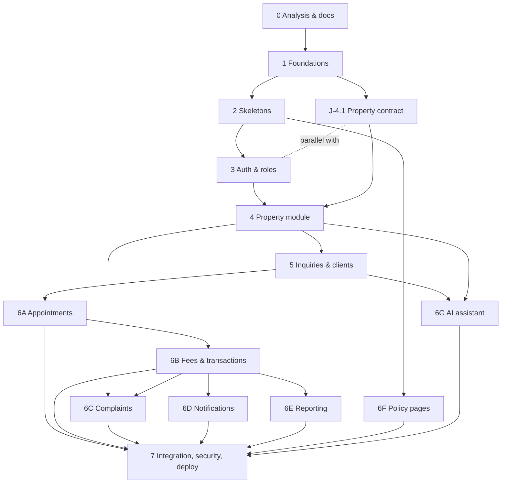

# Implementation Plan

**Status:** Draft v0.2 — awaiting approval (J-0.3) · **Joint ownership** · Generated together with `docs/PROGRESS.md` from one task list; edit both when tasks change.

This plan refines the requested phase sequence against the actual PRD dependencies. Differences from the brief:

1. **Contract-freeze tasks (`J-x.1`) precede every module.** Frontend and backend only work in parallel once the interface is `Agreed`.
2. **Phase 4's contract freeze (J-4.1) can overlap Phase 3**, because it needs only the Phase 1 conventions, not working auth.
3. **"Leads and clients" (Phase 5) are inquiries and clients** (PRD §1 vocabulary mapping).
4. **Phase 6 is split into six dependency-ordered sub-modules** (6A appointments, 6B fees and transactions, 6C complaints, 6D notifications, 6E reporting, 6F policy pages) instead of one bulk phase, so no task spans multiple major modules.
5. **Complaints/suspicious-listing reports** (PRD FR-CMP) and **policy/consent pages** (FR-POL) are added: the proposal makes them part of the MVP (§9F–G).
6. **Payment gateway is deferred** (J-6.13) pending legal review and OQ-06.
7. **v0.2 additions after team review:** complaint investigation (verify before action, confidential reporters) expands 6C; an **AI assistant with call-line handoff** is added as sub-module 6G (priority Should, pending confirmation); currency/format conventions and unknown-error-code handling are built into J-1.3, BE-2.2, FE-2.3 and BE-6.8.

## 1. Rules for every task

**Before coding** the owner writes a *Task Brief* (template in `agents/ORCHESTRATOR.md` §4) covering: objective, owner, required documentation, files expected to change, dependencies, acceptance criteria, tests required.

**After coding:** run the relevant tests; report **actual** results; update documentation if contracts or architecture changed; update `docs/PROGRESS.md`; name the next unblocked task.

**Never** implement more than one major module in one task. A task is one owner's work, finishable and testable on its own, except `J-` integration/freeze tasks which are explicitly shared.

**Task ID scheme:** `FE-p.n` Frontend, `BE-p.n` Backend, `J-p.n` Joint (lead named). `p` = phase.

**Priorities:** Must · Should · Could · Deferred (see PRD §6).

**Definition of Ready:** all dependencies Done; no unresolved open question in the *Blockers* column (or its default accepted in `docs/DECISIONS.md`); contract status for every endpoint the task touches is `Agreed` or later; a Task Brief exists.

**Definition of Done:** acceptance criteria met; tests written and passing (output summarised in PROGRESS); lint/type checks green; docs updated; PR reviewed by the other developer using `agents/CODE_REVIEWER.md`; no TEMP-MOCK left for features claiming acceptance; PROGRESS updated.

## 2. Summary

| | Count |
|---|---|
| Tasks in total | 91 |
| Frontend / Backend / Joint | 28 / 33 / 30 |
| Must / Should / Could / Deferred | 72 / 16 / 2 / 1 |

Longest dependency chain among Must tasks (20 tasks): `J-0.1 → J-0.2 → J-0.3 → J-1.1 → J-2.1 → BE-2.2 → BE-3.1 → BE-3.2 → BE-3.3 → BE-4.5 → BE-4.6 → BE-4.9 → J-4.15 → J-5.10 → J-6.6 → J-6.12 → J-7.1 → BE-7.2 → J-7.7 → J-7.8`

## 3. Phase overview

| Phase | Goal | Exit criteria |
|---|---|---|
| 0 Analysis and documentation | Understand the PRD, find gaps, propose the MVP, create instruction files and shared docs. | MVP scope, ADRs and defaults recorded in `docs/DECISIONS.md`; approval is welcome but not a gate (ADR-019). |
| 1 Foundations: architecture, schema, API conventions, design system | Agree everything both sides depend on before any code: conventions, core schema, auth contract, design system. | ADRs accepted; schema covers all tables through Phase 4; auth + health contract `Agreed`; design system v1 done; blocking open questions for Phases 2–4 resolved. |
| 2 Project skeletons | Create independent frontend and backend skeletons plus shared repo plumbing and contract tooling. | Both skeletons build and pass CI; FE renders backend health through the real client; OpenAPI → generated types works. |
| 3 Authentication and role permissions | Client registration/login, staff accounts, RBAC and the UI to use them. | Auth E2E passes against the real backend; client blocked from admin routes; no auth mocks remain. |
| 4 Property module (end to end) | Landlord submission → staff verification and approval → publication → public search and detail. | A property submitted through the public form, verified and approved by staff, appears in public search and detail; unpublishing removes it; no private data leaks; all mocks gone. |
| 5 Inquiries (leads) and clients (end to end) | Clients express interest; staff run an inquiry pipeline with in-platform messaging and a client directory. | Client expresses interest, staff reply and qualify, client sees the reply; internal notes never exposed; mocks gone. |
| 6 Appointments, transactions, complaints, notifications, reporting, policies, AI assistant | Complete the operational workflow: inspections, fees and transactions, complaint investigation, email notifications, KPIs, legal pages, and an AI assistant with human call-line handoff. | Each sub-module (6A–6G) has its own integration task and passes before the next dependent one starts. |
| 7 Integration testing, security review, bug fixes, deployment | Prove the whole product works together, is secure, performs, and can be deployed and operated. | Release acceptance checklist signed by both developers; production deployed; hypercare window open. |

## 4. Dependency map (phase level)

## 5. Parallel lanes (when both developers can work at once)

| Window | Frontend lane | Backend lane | Condition that makes it safe |
|---|---|---|---|
| Phase 1 | FE-1.4 design system | BE-1.2 schema | Disjoint files; both read approved PRD |
| Phase 2 | FE-2.3 skeleton → FE-2.5 → FE-2.7 | BE-2.2 → BE-2.4 → BE-2.6 | `/health` and error envelope agreed in J-1.3; FE-2.5 waits for BE-2.4 |
| Phase 3 | FE-3.5 (mock) → FE-3.6 → FE-3.8 | BE-3.1 → 3.2 → 3.3 → 3.4 | Auth endpoints `Agreed` (J-1.3); integration gate J-3.7 |
| Phase 3–4 overlap | — | — | J-4.1 is joint contract work; both devs do it before Phase 4 coding |
| Phase 4 | FE-4.10…4.14 (mock) | BE-4.2…4.8 → BE-4.9 | Property endpoints `Agreed` (J-4.1); mocks only for `Agreed` endpoints; gate J-4.15 |
| Phase 5 | FE-5.6…5.9 (mock) | BE-5.2…5.5 | Inquiry endpoints `Agreed` (J-5.1); gate J-5.10 |
| Phase 6A–6E | Screens (mock) | Models and APIs | Each sub-module's freeze task done; each ends with its own J- gate |
| Phase 6F | FE-6.26 any time after FE-2.3 | BE-6.27 (Could) | Independent of other modules |
| Phase 6G | FE-6.32, FE-6.33 (mock) | BE-6.29 → BE-6.30 → BE-6.31 | J-6.28 `Agreed`; call line, provider and FAQ content decided (OQ-23…25); gate J-6.34 |
| Phase 7 | FE-7.3, FE-7.6 | BE-7.2, BE-7.5 | J-7.1 complete (deployment setup may start earlier) |

**Do not parallelise** when: an endpoint is `Draft`; two tasks edit the same shared file; a migration depends on another unmerged migration; a task's dependency is not Done.

## 6. After approval, first unblocked tasks

`J-1.1`, `BE-1.2`, `FE-1.4`, `J-1.5` (J-1.3 follows J-1.1).

## 7. Task details

### Phase 0 — Analysis and documentation

**Goal:** Understand the PRD, find gaps, propose the MVP, create instruction files and shared docs.  
**Exit criteria:** MVP scope, ADRs and defaults recorded in `docs/DECISIONS.md`; approval is welcome but not a gate (ADR-019).  
**Parallelism:** Nothing is built in this phase. Output is documents only.

| ID | Task | Owner | Pri | Depends on | Files expected to change | Acceptance criteria | Tests required | Blockers |
|---|---|---|---|---|---|---|---|---|
| J-0.1 | Analyze the PRD, extract requirements, list gaps | Both | Must | — | PRD.md | Requirements, gaps, open questions and MVP proposal written | Peer review | — |
| J-0.2 | Create agent instruction files and shared documents | Both | Must | J-0.1 | agents/*, docs/*, PRD.md | All 14 required files exist; IDs and cross-references resolve | Automated cross-reference check | — |
| J-0.3 | Review and approve MVP scope, ADRs and defaults for open questions | Both | Must | J-0.2 | PRD.md, docs/DECISIONS.md | Approvals recorded in DECISIONS.md when convenient (not a gate); PRD status set to Approved v1.0 | — | OQ-21, OQ-22 |

### Phase 1 — Foundations: architecture, schema, API conventions, design system

**Goal:** Agree everything both sides depend on before any code: conventions, core schema, auth contract, design system.  
**Exit criteria:** ADRs accepted; schema covers all tables through Phase 4; auth + health contract `Agreed`; design system v1 done; blocking open questions for Phases 2–4 resolved.  
**Parallelism:** BE-1.2 and FE-1.4 run in parallel (no shared files).

| ID | Task | Owner | Pri | Depends on | Files expected to change | Acceptance criteria | Tests required | Blockers |
|---|---|---|---|---|---|---|---|---|
| J-1.1 | Ratify ADR-001…013 (accept or amend) and the NFR targets | Both | Must | J-0.3 | docs/DECISIONS.md, docs/ARCHITECTURE.md | Each ADR marked Accepted or amended with both approvals | — | OQ-19 |
| BE-1.2 | Finalize schema conventions and core tables through Phase 4 (users, areas, amenities, landlords, properties, media, documents, verification, approvals, history) | Backend | Must | J-0.3 | docs/DATABASE_SCHEMA.md | Every table through Phase 4 has types, constraints, indexes and PII class; ERD current; FE confirms API shapes can be served | Schema review checklist (no code) | — |
| J-1.3 | Finalize API conventions, auth + health + policies endpoints; adopt change protocol | Both | Must | J-1.1 | docs/API_CONTRACT.md | Conventions agreed (incl. currency/formatting §2.10 and unknown-error-code handling §2.4); auth, health, `/policies/current` endpoints status `Agreed` with request/response examples; permission matrix covers them | — | OQ-09 |
| FE-1.4 | Design system v1: tokens, AA contrast results, component inventory, page templates, copy rules | Frontend | Must | J-0.3 | docs/UI_DESIGN_SYSTEM.md | All tokens defined; contrast table complete; every Phase 3–4 screen has a template; BE confirms data needs (§11) | Contrast check results recorded | OQ-01 (non-blocking: placeholder brand) |
| J-1.5 | Resolve or accept defaults for blocking open questions of Phases 2–4 | Both | Must | J-0.3 | PRD.md §10.2, docs/DECISIONS.md | OQ-02, 05, 07, 10, 11, 12, 13 each marked Decided (with date) or Default accepted | — | OQ-02, 05, 07, 10, 11, 12, 13 |

### Phase 2 — Project skeletons

**Goal:** Create independent frontend and backend skeletons plus shared repo plumbing and contract tooling.  
**Exit criteria:** Both skeletons build and pass CI; FE renders backend health through the real client; OpenAPI → generated types works.  
**Parallelism:** BE-2.2 and FE-2.3 run in parallel after J-2.1. BE-2.4 → FE-2.5 is the only cross-dependency.

| ID | Task | Owner | Pri | Depends on | Files expected to change | Acceptance criteria | Tests required | Blockers |
|---|---|---|---|---|---|---|---|---|
| J-2.1 | Repo scaffolding: README, .gitignore, CODEOWNERS, PR template, docker-compose (Postgres, MinIO, Mailpit), .env.example | Both (lead: Backend) | Must | J-1.1 | README.md, .github/CODEOWNERS, .github/PULL_REQUEST_TEMPLATE.md, docker-compose.yml, .env.example, .gitignore | Fresh clone + README gets Postgres up; CODEOWNERS assigns paths per ARCHITECTURE §3; PR template carries the task checklist | Manual setup walkthrough on a clean machine | — |
| BE-2.2 | FastAPI skeleton: app factory, settings, DB session, Alembic baseline, /health, error envelope, request-ID logging, pytest, ruff, mypy | Backend | Must | J-2.1, J-1.3 | backend/** | `GET /api/v1/health` matches contract; validation, 404, 503 and unhandled-exception errors use the envelope (unhandled → INTERNAL_ERROR, no internals); `Money` schema rejects non-NGN and non-integer amounts; every emitted error code is in the contract registry; `alembic upgrade head`/`downgrade base` clean | pytest: health, envelope for 404/422/500/503, request-ID header, error-code registry test, Money schema vectors; alembic up/down | — |
| FE-2.3 | Next.js skeleton: App Router, strict TS, Tailwind tokens, route-group layouts, API client with envelope parsing, env config, lint/typecheck/test tooling | Frontend | Must | J-2.1, FE-1.4 | frontend/** | App builds; public/auth/client/admin layouts render; client converts envelope into typed `ApiError` (`code: string`) and degrades safely on unknown codes, non-JSON, network and timeout failures; shared `formatMoney`/`formatMoneyCompact`/`parseMoneyInput` pass the contract vectors; tokens match design system | Vitest: api client incl. unknown-code/non-JSON/network/timeout cases; money formatter and parser vectors from API_CONTRACT §2.10; `tsc`, lint, build | — |
| BE-2.4 | Export OpenAPI and add contract drift check against the endpoint index in API_CONTRACT.md | Backend | Must | BE-2.2 | backend/scripts/*, backend/openapi.json, Makefile | `make openapi` writes openapi.json; check fails on undocumented or missing method+path pairs | Script tests with a deliberately drifted fixture | — |
| FE-2.5 | Generated TS API types from OpenAPI; MSW mock layer with TEMP-MOCK labelling and mock-audit script | Frontend | Must | BE-2.4, FE-2.3 | frontend/src/lib/api/**, frontend/src/mocks/**, frontend/scripts/mock-audit.* | `npm run api:types` regenerates types; every mock handler carries `TEMP-MOCK` label; mock-audit lists active mocks; a single flag disables all mocks | Vitest: mock registry/labels test; typecheck against generated types | — |
| BE-2.6 | Backend CI workflow (lint, mypy, tests with Postgres service, migration check, openapi drift, dependency audit) | Backend | Must | BE-2.2, BE-2.4 | .github/workflows/backend.yml | Runs on `backend/**` PRs; required check; fails on drift or failing tests | CI green on skeleton; intentionally broken PR fails | — |
| FE-2.7 | Frontend CI workflow (lint, typecheck, unit tests, build, mock-audit, dependency audit) | Frontend | Must | FE-2.3, FE-2.5 | .github/workflows/frontend.yml | Runs on `frontend/**` PRs; required check; prints active mocks | CI green on skeleton; intentionally broken PR fails | — |
| J-2.8 | Skeleton integration smoke: frontend reaches real /health through the `/api` rewrite; dev docs | Both (lead: Frontend) | Must | BE-2.2, FE-2.3, FE-2.5 | README.md, docs/ARCHITECTURE.md (corrections only), e2e/smoke | docker-compose + both dev servers: UI shows backend status; CORS not needed; documented commands work | Playwright smoke against real stack | — |

### Phase 3 — Authentication and role permissions

**Goal:** Client registration/login, staff accounts, RBAC and the UI to use them.  
**Exit criteria:** Auth E2E passes against the real backend; client blocked from admin routes; no auth mocks remain.  
**Parallelism:** Backend tasks BE-3.1→3.3 run in parallel with FE-3.5 (mock-backed). J-4.1 (contract only) may run in parallel with this phase.

| ID | Task | Owner | Pri | Depends on | Files expected to change | Acceptance criteria | Tests required | Blockers |
|---|---|---|---|---|---|---|---|---|
| BE-3.1 | User, session and token models + migration; admin seed command | Backend | Must | BE-2.2, BE-1.2 | backend/app/models/user.py, alembic/versions/*, backend/app/cli.py | Migration up/down clean; unique case-insensitive email; seed-admin creates admin from env, idempotently | Model tests, migration tests, CLI test | — |
| BE-3.2 | Register (client), login, refresh, logout, me, policies/current — Argon2id, cookie sessions, CSRF | Backend | Must | BE-3.1, J-1.3 | backend/app/api/v1/auth.py, services/auth.py, schemas/auth.py, core/security.py | Endpoints match contract; refresh rotation + reuse detection; cookie flags correct; generic login error; consent versions recorded | Unit + API tests incl. negative paths (bad creds, reuse, missing CSRF, duplicate email) | — |
| BE-3.3 | RBAC dependencies (default deny), staff user management API, login rate limiting, audit log basics | Backend | Must | BE-3.2 | backend/app/core/permissions.py, api/v1/admin_users.py, services/audit.py | Permission matrix tests exist for every protected endpoint; admin cannot demote/deactivate self; 429 uses envelope + Retry-After | Authz matrix tests, rate-limit tests, audit-write tests | — |
| BE-3.4 | Password reset (single-use, ≤1 h) and email verification via email-service abstraction (console/Mailpit in dev) | Backend | Should | BE-3.2 | backend/app/services/email.py, api/v1/auth.py | Reset token single-use and expiring; no account enumeration; reset revokes sessions; email goes through outbox/abstraction | API tests, expiry tests, enumeration test | OQ-15 |
| FE-3.5 | Auth screens: login, register (with consent), forgot/reset password — mock-backed until BE-3.2/3.4 | Frontend | Must | FE-2.5, FE-1.4, J-1.3 | frontend/src/app/(auth)/**, components/features/auth/**, src/mocks/auth.* | Client validation mirrors contract; server field errors shown; a11y labels; loading/disabled states; mocks labelled TEMP-MOCK | Component tests: validation, server-error mapping, submit states | — |
| FE-3.6 | Session handling and route guards: role-based navigation, 401/403 handling, silent refresh, logout | Frontend | Must | FE-3.5 | frontend/src/middleware.ts, src/lib/auth/**, app/(client)/layout, app/(admin)/layout | Unauthenticated → login; wrong role → Forbidden page; one refresh attempt on TOKEN_EXPIRED; UI hides unauthorised actions (display only) | Unit tests for guards and refresh interceptor | — |
| FE-3.8 | Admin staff-management screens (list, create, activate/deactivate, role) | Frontend | Should | FE-3.6, J-1.3 | frontend/src/app/(admin)/admin/users/** | Admin-only route; forms use contract validation; self-demotion blocked in UI and by API | Component tests; E2E in J-3.7 | — |
| J-3.7 | Auth integration: remove auth mocks; E2E register→login→me→refresh→logout; client blocked from /admin; staff allowed | Both (lead: Backend) | Must | BE-3.3, FE-3.6, FE-3.5 | e2e/auth.spec.*, docs/API_CONTRACT.md (status → Integrated) | E2E green on real backend; no TEMP-MOCK for auth left; auth endpoints `Integrated` | Playwright E2E | — |

### Phase 4 — Property module (end to end)

**Goal:** Landlord submission → staff verification and approval → publication → public search and detail.  
**Exit criteria:** A property submitted through the public form, verified and approved by staff, appears in public search and detail; unpublishing removes it; no private data leaks; all mocks gone.  
**Parallelism:** Freeze contract in J-4.1 first. Then BE-4.2…4.8 and FE-4.10…4.14 run in parallel; FE uses labelled mocks until each endpoint is Implemented.

| ID | Task | Owner | Pri | Depends on | Files expected to change | Acceptance criteria | Tests required | Blockers |
|---|---|---|---|---|---|---|---|---|
| J-4.1 | Freeze property contract: taxonomy, lifecycle, verification and approval fields, upload flow, public/private field matrix, `allowed_actions` | Both (lead: Backend) | Must | J-1.3, J-1.5 | docs/API_CONTRACT.md, docs/DATABASE_SCHEMA.md, docs/UI_DESIGN_SYSTEM.md (§11) | Every property endpoint `Agreed` with full request/response examples and error cases; amenity and area lists fixed; both approve | — | OQ-02, 05, 07, 10, 11, 13 |
| BE-4.2 | Property domain models + migrations; seed amenities and areas | Backend | Must | BE-3.1, J-4.1 | backend/app/models/property*.py, alembic/versions/*, backend/app/seeds/* | Migration up/down clean; constraints from schema doc enforced; seed idempotent | Model/constraint tests, migration tests | — |
| BE-4.3 | Media and document service: storage abstraction (local/S3), content-sniff validation, limits, private docs, thumbnails, EXIF stripping, signed URLs | Backend | Must | BE-4.2 | backend/app/services/storage.py, services/media.py | Disallowed type/size rejected with 415/413; documents never publicly reachable; signed URLs expire; thumbnails produced; EXIF GPS removed | Unit tests with malicious/oversized/mis-typed fixtures | — |
| BE-4.4 | Public landlord submission endpoints (draft, upload token, files, submit) with rate limits and CAPTCHA hook | Backend | Must | BE-4.2, BE-4.3, BE-3.3 | backend/app/api/v1/landlord_submissions.py, services/submission.py | Matches contract; submit blocked without ≥5 photos + ≥1 evidence document; token scoped to one submission; landlord PII stored privately; consent recorded | API tests: happy path, limits, wrong token, rate limit, privacy | — |
| BE-4.5 | Staff property API: queue with filters, detail (incl. signed docs, landlord), edit with optimistic version, assign, media management, availability, landlord directory | Backend | Must | BE-4.2, BE-3.3 | backend/app/api/v1/admin_properties.py, admin_landlords.py, services/property_admin.py | Staff/admin only; version conflict → 409; price/description edit invalidates approval; `stale_availability` filter works (14-day default) | Authz matrix, version conflict, invalidation, filter tests | — |
| BE-4.6 | Verification recording, landlord-approval recording, status state machine and publish guards | Backend | Must | BE-4.5, BE-4.3 | backend/app/services/property_workflow.py, api/v1/admin_properties.py | Transition table from contract enforced; publish requires passed verification and current approval; every transition written to status history and audit | State-machine table tests (all legal and illegal transitions), guard tests, history tests | — |
| BE-4.7 | Public search and detail API + taxonomy endpoint with indexes | Backend | Must | BE-4.2 | backend/app/api/v1/properties.py, taxonomy.py, services/search.py | All filters/sorts per contract; only published; unknown filter → 422; no private field in response; p95 target met on seed data | API tests per filter, pagination edge cases, privacy-leak test, EXPLAIN check | — |
| BE-4.8 | Dev seed data: ≥30 properties across statuses, 10 clients, 3 staff | Backend | Must | BE-4.2, BE-4.3 | backend/app/seeds/dev.py | `make seed` populates a usable dataset; includes unpublished/rejected to test visibility; idempotent | Seed run test | — |
| BE-4.9 | Property module hardening: privacy-leak sweep, query plans, docs sync | Backend | Must | BE-4.4, BE-4.5, BE-4.6, BE-4.7, BE-4.8 | backend/tests/**, docs/DATABASE_SCHEMA.md, docs/API_CONTRACT.md (status → Implemented) | Automated test proves no public/client endpoint exposes P3 fields; EXPLAIN shows index use; all property endpoints `Implemented`; OpenAPI drift check green | Full backend suite; leak test; EXPLAIN evidence in PR | — |
| FE-4.10 | Landlord submission multi-step form with upload UI (mock-backed until BE-4.4) | Frontend | Must | FE-2.5, FE-1.4, J-4.1 | frontend/src/app/(public)/list-your-property/**, components/features/submission/** | All steps validate per contract; uploads show progress/retry/remove; review step; consent captured; privacy explanation shown | Component tests per step; mocked E2E happy path | — |
| FE-4.11 | Property search page: URL-synced filters, sort, pagination, loading/empty/error states (mock-backed until BE-4.7) | Frontend | Must | FE-2.5, FE-1.4, J-4.1 | frontend/src/app/(public)/properties/**, components/features/property/** | Every filter in the contract reflected in URL; mobile filter drawer; shareable URLs; SSR for SEO | Component tests; URL-state tests; mocked E2E | — |
| FE-4.12 | Property detail page: gallery, facts, verification panel with scope and disclaimer, availability, SEO metadata, inert interest CTA | Frontend | Must | FE-4.11 | frontend/src/app/(public)/properties/[slug]/** | Matches design system §9; verification copy follows §5; metadata and structured data present; 404 for unpublished | Component tests; metadata test; mocked E2E | — |
| FE-4.13 | Homepage: hero, three CTAs, search entry, featured verified listings, trust section | Frontend | Must | FE-4.11 | frontend/src/app/(public)/page.tsx, components/features/home/** | CTAs route correctly; featured list from API; LCP budget respected | Component tests; Lighthouse check recorded | — |
| FE-4.14 | Admin shell + property review queue, landlord list, review/verification screen with transition actions | Frontend | Must | FE-3.6, J-4.1 | frontend/src/app/(admin)/admin/properties/**, admin/landlords/**, components/features/admin-property/** | Queue filters; documents via signed URLs; checklist + approval forms; actions limited to API `allowed_actions`; 409/403 handled | Component tests; mocked E2E of full review | — |
| J-4.15 | Property integration: remove mocks; E2E submit→review→verify→approve→publish→search→detail→unpublish; privacy checks | Both (lead: Backend) | Must | BE-4.9, FE-4.10, FE-4.11, FE-4.12, FE-4.13, FE-4.14, J-3.7 | e2e/property.spec.*, docs/API_CONTRACT.md (status → Integrated), docs/PROGRESS.md | E2E green on real stack; no TEMP-MOCK for property features; landlord data absent from every public page and response | Playwright E2E incl. privacy assertions | — |

### Phase 5 — Inquiries (leads) and clients (end to end)

**Goal:** Clients express interest; staff run an inquiry pipeline with in-platform messaging and a client directory.  
**Exit criteria:** Client expresses interest, staff reply and qualify, client sees the reply; internal notes never exposed; mocks gone.  
**Parallelism:** J-5.1 can run in parallel with Phase 4 development (contract only). BE-5.x and FE-5.x then run in parallel.

| ID | Task | Owner | Pri | Depends on | Files expected to change | Acceptance criteria | Tests required | Blockers |
|---|---|---|---|---|---|---|---|---|
| J-5.1 | Freeze inquiry, messaging and client contract: lifecycle, qualification fields, assignment, internal notes, warnings | Both (lead: Backend) | Must | J-4.1, J-1.5 | docs/API_CONTRACT.md, docs/DATABASE_SCHEMA.md | All inquiry/message/client endpoints `Agreed` with examples; transition table fixed; client-visible vs staff-only fields listed | — | OQ-08, OQ-14 |
| BE-5.2 | Inquiry, message, note and history models + migration | Backend | Must | BE-4.2, J-5.1 | backend/app/models/inquiry*.py, alembic/versions/* | Migration up/down clean; partial unique index prevents duplicate open inquiry per client+property | Model/constraint tests, migration tests | — |
| BE-5.3 | Client inquiry API: create (idempotent), list own, thread, post message | Backend | Must | BE-5.2, BE-3.2 | backend/app/api/v1/inquiries.py, services/inquiry.py | Clients see only own inquiries (404 otherwise); duplicate open inquiry → 409; rate limit; internal notes never serialised | Authz tests, duplicate test, idempotency test, privacy test | — |
| BE-5.4 | Staff inquiry API: pipeline filters, assign, transitions, qualification, internal notes, reply | Backend | Must | BE-5.2, BE-3.3 | backend/app/api/v1/admin_inquiries.py, services/inquiry_admin.py | Transition table enforced; status history and audit written; reply visible to client; notes not | State-machine tests, authz matrix, visibility tests | — |
| BE-5.5 | Admin client directory API (list, detail with history, deactivate) | Backend | Must | BE-5.2, BE-3.3 | backend/app/api/v1/admin_clients.py | Staff/admin only; client PII visible to staff only; deactivation blocks login | Authz tests, deactivation test | — |
| FE-5.6 | Express-interest flow on property detail + "Speak to our team" page (login gate, short qualification form, success state) | Frontend | Must | FE-4.12, FE-3.6, J-5.1 | frontend/src/components/features/inquiry/**, app/(public)/contact/** | Anonymous user is guided to login/register and returned; form validated; duplicate-inquiry error handled; CTA live on detail page | Component tests; mocked E2E | — |
| FE-5.7 | Client area: my inquiries list and thread view with refresh and off-platform warning | Frontend | Must | FE-3.6, J-5.1, FE-1.4 | frontend/src/app/(client)/account/inquiries/** | Shows only own data; composer works; warning banner present; refresh every 30 s while open | Component tests; mocked E2E | — |
| FE-5.8 | Admin inquiry inbox/pipeline: filters, detail, reply, assign, status, qualification, internal notes | Frontend | Must | FE-4.14, J-5.1 | frontend/src/app/(admin)/admin/inquiries/** | Internal notes visually distinct from replies; transitions limited to allowed actions; unread indicator | Component tests; mocked E2E | — |
| FE-5.9 | Admin client directory and client detail | Frontend | Must | FE-4.14, J-5.1 | frontend/src/app/(admin)/admin/clients/** | List/search/detail with inquiry history; deactivate with confirm dialog | Component tests | — |
| J-5.10 | Inquiry integration: remove mocks; E2E interest→staff reply→client sees reply; notes never exposed | Both (lead: Frontend) | Must | BE-5.3, BE-5.4, BE-5.5, FE-5.6, FE-5.7, FE-5.8, FE-5.9, J-4.15 | e2e/inquiry.spec.*, docs/API_CONTRACT.md (→ Integrated) | E2E green; internal-note leak assertion passes; no TEMP-MOCK for inquiry features | Playwright E2E | — |

### Phase 6 — Appointments, transactions, complaints, notifications, reporting, policies, AI assistant

**Goal:** Complete the operational workflow: inspections, fees and transactions, complaint investigation, email notifications, KPIs, legal pages, and an AI assistant with human call-line handoff.  
**Exit criteria:** Each sub-module (6A–6G) has its own integration task and passes before the next dependent one starts.  
**Parallelism:** Sub-modules are ordered by dependency: 6A appointments → 6B fees/transactions → 6C complaints → 6D notifications → 6E reporting. 6F (policy pages) is independent and may start any time after FE-2.3. 6G (AI assistant) needs Phase 5 (handoff creates inquiries), the property search API, and approved knowledge content; it is otherwise independent.

| ID | Task | Owner | Pri | Depends on | Files expected to change | Acceptance criteria | Tests required | Blockers |
|---|---|---|---|---|---|---|---|---|
| J-6.1 | 6A Freeze appointment contract: lifecycle, parties, reschedule/cancel rules, address disclosure, fee fields | Both (lead: Backend) | Must | J-5.1 | docs/API_CONTRACT.md, docs/DATABASE_SCHEMA.md | Endpoints `Agreed`; transition table fixed; exact-address disclosure rule encoded; fee fields match OQ-04 outcome | — | OQ-04, OQ-11 |
| BE-6.2 | 6A Appointment models + staff scheduling API with conflict detection | Backend | Must | BE-5.2, J-6.1 | backend/app/models/appointment.py, api/v1/admin_appointments.py, services/appointment.py | Overlap for same staff/property rejected (409); links inquiry→appointment; status history + audit; inquiry status moves to `inspection_scheduled` | Conflict tests, state-machine tests, authz matrix, migration tests | — |
| BE-6.3 | 6A Client appointment API (view, confirm, cancel, request reschedule) and staff outcome recording; exact address after confirmation | Backend | Must | BE-6.2, BE-5.3 | backend/app/api/v1/appointments.py | Client sees only own; exact address appears only after confirmation; cancellations by role recorded; outcome stored | Authz tests, disclosure tests, transition tests | — |
| FE-6.4 | 6A Admin appointment list/calendar, schedule-from-inquiry form, outcome form | Frontend | Must | FE-5.8, J-6.1 | frontend/src/app/(admin)/admin/appointments/** | Create from inquiry; conflict error shown; outcome recorded; list filters by date/status/staff | Component tests; mocked E2E | — |
| FE-6.5 | 6A Client appointment views: details, confirm/cancel/reschedule request, fee disclosure text | Frontend | Must | FE-5.7, J-6.1 | frontend/src/app/(client)/account/appointments/** | Shows disclosure text from API before any fee-implying action; exact address shown only when API returns it | Component tests; mocked E2E | — |
| J-6.6 | 6A Appointment integration: remove mocks; E2E schedule→confirm→complete; disclosure rule verified | Both (lead: Backend) | Must | BE-6.3, FE-6.4, FE-6.5, J-5.10 | e2e/appointment.spec.* | E2E green; exact address absent before confirmation; no TEMP-MOCK left | Playwright E2E | — |
| J-6.7 | 6B Freeze fee and transaction contract: rules, calculation basis, lifecycle, ledger, disclosure fields | Both (lead: Backend) | Must | J-6.1 | docs/API_CONTRACT.md, docs/DATABASE_SCHEMA.md, PRD.md (BR updates) | OQ-03/04/06 decided or defaults accepted; worked examples from the proposal written into the contract; endpoints `Agreed` | — | OQ-03, OQ-04, OQ-06 |
| BE-6.8 | 6B Fee rules configuration and calculation service (pure functions, kobo, rounding, rent vs sale) | Backend | Must | J-6.7 | backend/app/models/fee_rule.py, services/fees.py, api/v1/admin_fee_rules.py | ₦50m sale at 2% ⇒ ₦1,000,000 per party; half-up integer rounding `(base*bps+5000)//10000` matches the contract vectors; rent bases follow OQ-03; rules versioned, never edited; snapshot stored on transactions | Exhaustive unit tests (table-driven incl. rounding, min/max, boundaries); authz tests | — |
| BE-6.9 | 6B Transaction and ledger models + staff API: create, events, fee invoice, manual payment recording, complete/cancel, audit; client summary | Backend | Must | BE-6.8, BE-6.2, BE-5.4 | backend/app/models/transaction.py, ledger.py, api/v1/admin_transactions.py, transactions.py, services/transaction.py | State machine enforced; ledger append-only (corrections by reversal); fees come only from the service; client summary shows own only | State-machine tests, ledger immutability test, authz matrix, reversal test, migration tests | — |
| FE-6.10 | 6B Admin transaction and fee screens (terms timeline, fee breakdown from API, payment recording) | Frontend | Must | FE-5.8, J-6.7 | frontend/src/app/(admin)/admin/transactions/** | No fee arithmetic in frontend (lint/grep check + review); ledger shown; reversal flow; actions from API | Component tests; mocked E2E | — |
| FE-6.11 | 6B Client fee explainer page and transaction summary in account area | Frontend | Must | FE-5.7, J-6.7 | frontend/src/app/(client)/account/transactions/**, app/(public)/policies/fees/** | Shows fee, payer, basis and refund/credit rules from API/content before agreement; off-platform warning present | Component tests | — |
| J-6.12 | 6B Transaction integration: remove mocks; E2E inquiry→appointment→transaction→fees→payment→complete; worked-example cross-check | Both (lead: Backend) | Must | BE-6.9, FE-6.10, FE-6.11, J-6.6 | e2e/transaction.spec.* | E2E green; ledger totals equal displayed fees; fee figures equal the worked examples in the contract | Playwright E2E + numeric assertions | — |
| J-6.13 | 6B Payment gateway integration (webhooks, reconciliation) — deferred until legal and product approval | Both (lead: Backend) | Deferred | J-6.12 | TBD (new ADR) | Only started after an approved ADR and OQ-06 decision | TBD | OQ-06 |
| J-6.14 | 6C Freeze complaint, suspicious-listing report and investigation contract (minimum fields, rate limits, privacy, verify-before-action) | Both (lead: Backend) | Must | J-4.1 | docs/API_CONTRACT.md, docs/DATABASE_SCHEMA.md | §4.8 endpoints `Agreed`; minimum fields, rate limits, privacy rules, outcomes and allowed actions fixed; staff-vs-admin action split fixed | — | OQ-16 |
| BE-6.15 | 6C Complaints/reports models and API: public report, client complaint, evidence upload, staff investigation (findings, outcome, actions), precautionary hold, reporter notification | Backend | Must | BE-6.9, BE-3.3, BE-4.3, J-6.14 | backend/app/models/complaint.py, api/v1/reports.py, complaints.py, admin_complaints.py | Minimum fields enforced; rate limits, honeypot, duplicate detection work; reporter identity only on admin schemas; cannot resolve without findings/outcome/action; permanent actions admin-only; hold sets review date and property history; counts never act automatically | API tests (envelope, limits, duplicates), state-machine tests, privacy-leak test, authz matrix incl. admin-only actions, card-number rejection | — |
| FE-6.16 | 6C Report-a-listing form, complaint form, my-complaints tracker, admin complaints queue and investigation screen | Frontend | Must | FE-4.14, FE-5.7, J-6.14 | frontend/src/app/(public)/report/**, app/(client)/account/complaints/**, app/(admin)/admin/complaints/** | Report reachable from every listing; only minimum fields; privacy sentence and reference shown; client sees status and public note only; admin sees investigation panel, hold banner and only the actions the API allows | Component tests (forms, states, role visibility); mocked E2E | — |
| J-6.17 | 6C Complaints integration: remove mocks; E2E report→triage→resolve | Both (lead: Backend) | Must | BE-6.15, FE-6.16 | e2e/complaints.spec.* | E2E green: report→triage→investigate→resolve with reporter identity absent for non-admin; duplicate and rate-limit paths; no TEMP-MOCK left | Playwright E2E | — |
| J-6.18 | 6D Freeze notification event catalog and (optional) in-app list contract | Both (lead: Backend) | Should | J-6.7 | docs/API_CONTRACT.md, docs/DATABASE_SCHEMA.md | Events, recipients, template names and trigger conditions listed; no PII beyond need | — | OQ-15 |
| BE-6.19 | 6D Notification outbox, worker, email sending and event hooks (inquiry reply, appointment changes, listing decisions, transaction updates) | Backend | Should | J-6.18, BE-6.9, BE-6.3, BE-5.4, BE-4.6 | backend/app/workers/**, services/notifications.py, templates/email/** | Outbox row written in same transaction; worker retries with backoff; failures never break requests; emails tested in Mailpit | Unit tests, retry tests, integration test with Mailpit | — |
| FE-6.20 | 6D In-app notification centre (bell, list, mark read) | Frontend | Could | FE-5.7, J-6.18 | frontend/src/components/features/notifications/**, app/(client)/account/notifications/** | Unread count; mark read; links to entities | Component tests | — |
| J-6.21 | 6D Notifications integration: E2E key events produce emails (and in-app if built) | Both (lead: Backend) | Should | BE-6.19 | e2e/notifications.spec.* | E2E green with Mailpit assertions | Playwright + Mailpit API | — |
| J-6.22 | 6E Freeze KPI definitions and reporting contract (system-derivable KPIs only) | Both (lead: Backend) | Should | J-6.7 | docs/API_CONTRACT.md, PRD.md §9 | Each KPI has formula, source columns, period; excluded KPIs listed | — | OQ-17 |
| BE-6.23 | 6E KPI aggregate endpoints with date ranges | Backend | Should | BE-6.9, BE-5.2, BE-4.2, J-6.22 | backend/app/api/v1/admin_reports.py, services/kpis.py | Numbers match hand-computed expectations on a fixture dataset; staff/admin only; query plans acceptable | Fixture-based unit tests, authz tests, EXPLAIN | — |
| FE-6.24 | 6E Admin dashboard home: queue counts, KPI cards/charts, date filter | Frontend | Should | FE-4.14, J-6.22 | frontend/src/app/(admin)/admin/page.tsx, components/features/reports/** | Matches API numbers; accessible chart alternatives; loading/empty states | Component tests | — |
| J-6.25 | 6E Reporting integration: remove mocks; verify KPIs against the dev seed | Both (lead: Backend) | Should | BE-6.23, FE-6.24 | e2e/reports.spec.* | Dashboard figures equal fixture expectations | Playwright E2E | — |
| FE-6.26 | 6F Policy and disclosure pages: terms, privacy, fees, verification limits, refunds, reporting (placeholder content until legal approval) | Frontend | Must | FE-2.3 | frontend/src/app/(public)/policies/**, content/policies/** | Pages exist, linked from footer and consent checkboxes; placeholder banner visible until counsel approves; version string matches `/policies/current` | Component tests; link check | OQ-01, OQ-18 |
| BE-6.27 | 6F Stale-availability job: flag listings not confirmed within the threshold | Backend | Could | BE-4.5, BE-6.19 | backend/app/workers/availability.py | Listings past the threshold appear under `stale_availability` and trigger a staff email | Time-travel tests | — |
| J-6.28 | 6G Freeze AI assistant contract and safety policy: scope and intents, knowledge-base rules, handoff triggers, call-line and hours config, guardrails, logging and retention, evaluation criteria | Both (lead: Backend) | Should | J-5.1, J-4.1 | docs/API_CONTRACT.md (§4.9), docs/DATABASE_SCHEMA.md, docs/UI_DESIGN_SYSTEM.md, PRD.md (§5.8) | §4.9 endpoints `Agreed`; handoff triggers and refusal categories fixed; call-line number and hours supplied (OQ-24); provider and data-sharing decided (OQ-23); initial FAQ list and ≥40-question golden set drafted (OQ-25) | — | OQ-23, OQ-24, OQ-25, OQ-26 |
| BE-6.29 | 6G Support settings, public-config endpoint, knowledge-article models and admin API (draft → admin publish) | Backend | Should | BE-3.3, J-6.28 | backend/app/models/knowledge.py, settings.py, api/v1/public_config.py, admin_knowledge.py, admin_settings.py | `/public-config` returns call line, hours and `is_open_now` (Africa/Lagos); only published articles are retrievable; only admins publish and change settings; changes audited; phone validated as E.164 | Unit tests for `is_open_now` across opening hours; authz matrix; audit tests; migration tests | — |
| BE-6.30 | 6G Assistant service and conversation API: LLM client interface (mock + real), retrieval over articles and public property search, deterministic handoff guards, output filter, rate limits, token budget, logging, message-the-team handoff | Backend | Should | BE-6.29, BE-4.7, BE-5.3, J-6.28 | backend/app/services/assistant/**, api/v1/assistant.py, models/assistant.py, alembic/versions/* | Answers only from approved sources with source references; every handoff includes the call option; output never contains a phone/email other than the support contact; assistant tools cannot reach landlord, user, inquiry or document data; provider error, timeout or budget exhaustion → 200 handoff `service_unavailable`; message-team handoff creates a `general` inquiry with transcript note; LLM key server-side only; rate limits per contract §6 | Unit tests with mock LLM for each handoff trigger; API tests (anonymous token, auth, limits, 1000-char cap, one-in-flight); privacy and output-filter tests; migration tests | — |
| BE-6.31 | 6G Assistant evaluation and red-team suite: golden Q&A, handoff cases, prompt injection (incl. in article text), PII extraction, legal/payment/complaint refusals | Backend | Should | BE-6.30 | backend/tests/assistant_eval/**, docs/PROGRESS.md | ≥ 90% of golden questions answered with the correct source; 100% of out-of-scope cases hand off with the call line; 100% of injection and PII cases pass; actual results recorded | Deterministic CI run with recorded/mock model outputs; documented live-model run before release | — |
| FE-6.32 | 6G Assistant chat widget: launcher, panel, disclosure, messages with source chips, handoff card (click-to-call, hours, message team, report listing), rate-limit/offline/error states | Frontend | Should | FE-5.6, J-6.28 | frontend/src/components/features/assistant/**, app layouts | AI disclosure shown; plain-text/safe-markdown rendering only; call link and hours always visible and from `/public-config`; handoff card for every handoff, `429` and failure; works at 360 px; keyboard and screen-reader operable; no keys or prompts in the client | Component tests (handoff variants, error/offline, no raw HTML); axe; mocked E2E | — |
| FE-6.33 | 6G Admin screens: knowledge-article editor, assistant conversation review (flagged, handed-off), support settings (call line, hours, enable toggle) | Frontend | Should | FE-4.14, J-6.28 | frontend/src/app/(admin)/admin/knowledge/**, admin/assistant/**, admin/settings/** | Staff draft articles, admins publish; flagged and handed-off conversations reviewable with notes; admin-only settings with E.164 and hours validation | Component tests (role visibility, validation) | — |
| J-6.34 | 6G Assistant integration: remove mocks; E2E answer from the knowledge base; out-of-scope → call line; message-team handoff creates an inquiry; injection and PII checks | Both (lead: Backend) | Should | BE-6.31, FE-6.32, FE-6.33, J-5.10 | e2e/assistant.spec.*, docs/API_CONTRACT.md (→ Integrated) | E2E green with the mock-LLM test mode; handoff card shows the configured call line; no private data in any transcript; manual live-model run recorded; no TEMP-MOCK left | Playwright E2E + live-model checklist | — |

### Phase 7 — Integration testing, security review, bug fixes, deployment

**Goal:** Prove the whole product works together, is secure, performs, and can be deployed and operated.  
**Exit criteria:** Release acceptance checklist signed by both developers; production deployed; hypercare window open.  
**Parallelism:** BE-7.5 and FE-7.6 (deployment setup) can start earlier in parallel to create a staging environment for UAT.

| ID | Task | Owner | Pri | Depends on | Files expected to change | Acceptance criteria | Tests required | Blockers |
|---|---|---|---|---|---|---|---|---|
| J-7.1 | Full regression: all core journeys E2E, bug triage list | Both (lead: Backend) | Must | J-6.6, J-6.12, J-6.17, J-6.21, J-6.25, J-6.34, FE-6.26 | e2e/**, docs/PROGRESS.md | All Must journeys pass on a clean database; defects logged with owner and severity | Full Playwright suite + all unit/API suites | — |
| BE-7.2 | Backend security review: authz sweep, validation, uploads, rate limits, secrets, headers, dependency audit, PII in logs | Backend | Must | J-7.1 | backend/**, docs/DECISIONS.md | ASVS L1 checklist completed with evidence; no open High/Critical; findings fixed or accepted via ADR; assistant red-team suite (BE-6.31) re-run and passing | Security test suite; `pip-audit`; manual checklist | — |
| FE-7.3 | Frontend security and quality review: XSS, CSP, cookie handling, a11y (axe + manual), responsive and low-bandwidth, Lighthouse | Frontend | Must | J-7.1 | frontend/** | No open High/Critical; axe clean on key pages; Lighthouse budgets met; CSP in place | axe in Playwright; Lighthouse CI; `npm audit` | — |
| J-7.4 | Performance and data-integrity pass: indexes, N+1, search plans, image optimisation, backup/restore drill | Both (lead: Backend) | Must | J-7.1 | backend/**, frontend/**, docs/ARCHITECTURE.md | NFR-01 targets met on a 5k-listing dataset; restore drill succeeds and is documented | Load test script results; restore drill log | — |
| BE-7.5 | Backend deployment: Docker image, production config, migrate-on-deploy, backups, retention purge job, logging/monitoring, health checks | Backend | Must | BE-2.6 | backend/Dockerfile, deploy/**, docs/ARCHITECTURE.md | Staging and production deployable from CI; rollback documented; backups scheduled; secrets only via env | Staging deploy + smoke | OQ-20 |
| FE-7.6 | Frontend deployment: build, env, caching, sitemap/robots, error pages, monitoring | Frontend | Must | FE-2.7 | frontend/**, deploy/** | Staging and production deployable; sitemap lists published properties; error boundary reports with request_id | Staging deploy + smoke | OQ-20 |
| J-7.7 | Staging UAT with real staff scenarios, fixes, legal content published, release acceptance checklist, go/no-go | Both (lead: Backend) | Must | BE-7.2, FE-7.3, J-7.4, BE-7.5, FE-7.6, FE-6.26 | docs/PROGRESS.md, docs/DECISIONS.md | UAT scenarios pass; counsel-approved policy content live; every Must requirement traced to a passing test; both developers sign | UAT script run | OQ-18 |
| J-7.8 | Production release and hypercare bug-fix window | Both (lead: Frontend) | Must | J-7.7 | docs/PROGRESS.md | Release tagged; monitoring reviewed daily for the agreed window; defects triaged | Production smoke | — |

## 8. Change control for this plan

Adding, splitting or re-prioritising a task needs the developer in charge's agreement (the other reviews at PR time) and an edit to **both** this file and `docs/PROGRESS.md`. Scope additions (anything not in PRD §5) go through `agents/PRODUCT_PLANNER.md` first.
